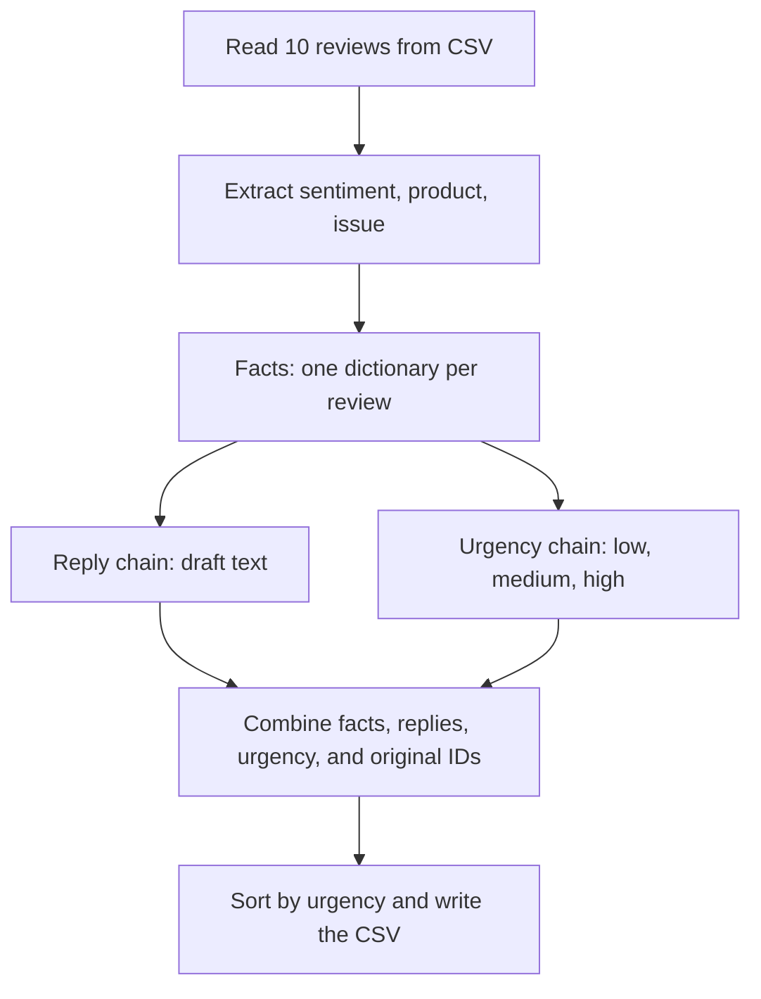

# TrailMix: sort 10 reviews for the support team

TrailMix Outdoors sells outdoor gear. Its support team needs to spot urgent
problems and draft polite replies. Your job is to turn **10 fictional reviews**
into one CSV, with urgent reviews first.

Start after completing sections 1–8 of the basics notebook. The lab reuses the
same schema, prompts, chains, and batch method. Every numbered code section has
comments explaining what it receives and what it produces.

## What happens



The extraction step runs before reply and urgency because those two branches
need its facts. The branches use the same input and do not depend on each other.
`RunnableParallel` collects their results under the names `reply` and `urgency`.
These are separate Gemini requests.

We use **two batch calls**: reviews become a facts list, then facts become a
drafts list. Both lists keep input order. Python's `zip` lets us read matching
items from the original reviews, facts, and drafts together to make CSV rows.

## Your three TODOs

Open `lab.py`. Keep the supplied schemas and prompts; fill in these blanks:

| TODO | What to connect | Notebook example |
| --- | --- | --- |
| 1, code section 3 | Extraction prompt and the structured model | 5b and 6 |
| 2, code section 6 | Reply and urgency with `RunnableParallel` | 7b |
| 3, code section 7 | Batch reviews into facts, then facts into drafts | 4a |

The starter stops with a TODO message until those blanks are filled.
The complete instructor version is on the `solution` branch at the same path.

## Read the code in order

| Code section | What it does |
| --- | --- |
| 1 | Load the key from `.env` and create the Gemini model |
| 2 | Read the 10 review dictionaries from `data/reviews.csv` |
| 3 | Extract the three required facts using a schema |
| 4 | Build the short reply chain |
| 5 | Build the urgency chain using a low/medium/high enum |
| 6 | Put reply and urgency into two named branches |
| 7 | Run the two batches and print the first result of each |
| 8 | Combine the six output columns using ordinary Python |
| 9 | Sort high first, then medium, then low |
| 10 | Write `output/triaged_reviews.csv` |

`enum` means a fixed list of allowed answers. All three fact fields are required
so the next prompts always have values for their blanks. `issue` is `none` when
there is no complaint. Keep safety details in that field: urgency depends on them.

## Run and inspect

Use the same virtual environment and root `.env` as the notebook. From the
repository root, run:

```sh
python 02-trailmix-reviews-lab/lab.py
```

The script prints how many reviews it loaded, the first extracted facts, the
first reply/urgency result, and where it saved the CSV. The 10 reviews use about
30 model requests: extraction, reply, and urgency for each review. If you see a
429 error, pause before retrying and reduce both batch concurrency settings to 1.
You can temporarily keep just the first two input rows while checking your TODOs.

Open `output/triaged_reviews.csv`. It has these columns:

| Column | Value |
| --- | --- |
| review_id | Original ID from the input |
| sentiment | positive, neutral, or negative |
| product | Product from the review |
| issue | Short problem description, or `none` |
| urgency | high for safety risk or injury; medium for other problems; low for no problem |
| draft_reply | Two polite sentences for a human to review |

## You are done when

- [ ] The file contains 10 rows and all six columns.
- [ ] The stove leaking gas and the overheating headlamp have high urgency.
- [ ] Positive reviews get suitable replies, and sarcasm is read as a complaint.
- [ ] High urgency comes first. The review IDs still match the right reviews.
- [ ] You have read the extracted facts and drafts for mistakes.
- [ ] Your API key stays in `.env` and out of your code.
