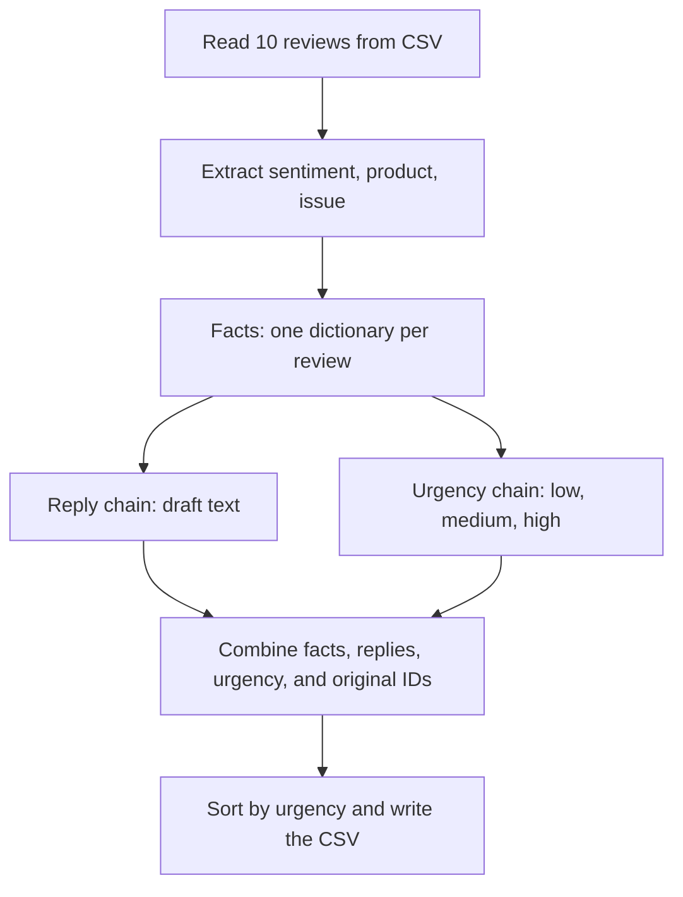

# TrailMix: sort 10 reviews for the support team

TrailMix Outdoors sells outdoor gear. Its support team needs to spot urgent
problems and draft polite replies. This complete example turns **10 fictional
reviews** into one CSV, with urgent reviews first.

All code is ready to run on **`main`**. Add your Gemini key to `.env`, then run
the script using the steps below. You do not need to edit any Python code.
The example reuses the schema, prompts, chains, and batch method from the basics
notebook. Numbered comments explain what each section receives and produces.

## What happens



The extraction step runs before reply and urgency because those two branches
need its facts. The branches use the same input and do not depend on each other.
`RunnableParallel` collects their results under the names `reply` and `urgency`.
These are separate Gemini requests.

We use **two batch calls**: reviews become a facts list, then facts become a
drafts list. Both lists keep input order. Python's `zip` lets us read matching
items from the original reviews, facts, and drafts together to make CSV rows.

## Read the code in order

| Code section | What it does |
| --- | --- |
| 1 | Load the key from `.env` and create the Gemini model |
| 2 | Read the 10 review dictionaries from `data/reviews.csv` |
| 3 | Extract the three required facts using a schema |
| 4 | Build the short reply chain |
| 5 | Build the urgency chain using a low/medium/high enum |
| 6 | Put reply and urgency into two named branches |
| 7 | Run the two batches and print the first result of each |
| 8 | Combine the six output columns using ordinary Python |
| 9 | Sort high first, then medium, then low |
| 10 | Write `output/triaged_reviews.csv` |

`enum` means a fixed list of allowed answers. All three fact fields are required
so the next prompts always have values for their blanks. `issue` is `none` when
there is no complaint. Keep safety details in that field: urgency depends on them.

## Run and inspect

1. Open a terminal in the repository folder, where the main README is. Use the
   same virtual environment and `.env` key as the basics notebook.
2. Run:

   ```sh
   python 02-trailmix-reviews-lab/lab.py
   ```

3. When the terminal says **`Saved 10 reviews to ...`**, open
   **`02-trailmix-reviews-lab/output/triaged_reviews.csv`** in your editor or Excel.
   Read all 10 results and check that urgent reviews come first.

The script creates the output folder and CSV for you. The file is saved on your
computer in the lab's `output` folder, rather than the repository's top level.
It is ignored by Git, so you will not see your generated results on GitHub.
Running the script again replaces the CSV.

If you see **429**, wait before retrying and lower both batch concurrency values
to 1. Processing all 10 reviews uses about 30 model requests.

Your CSV has these columns:

| Column | Value |
| --- | --- |
| review_id | Original ID from the input |
| sentiment | positive, neutral, or negative |
| product | Product from the review |
| issue | Short problem description, or `none` |
| urgency | high for safety risk or injury; medium for other problems; low for no problem |
| draft_reply | Two polite sentences for a human to review |

## Check the results

- [ ] The file contains 10 rows and all six columns.
- [ ] The stove leaking gas and the overheating headlamp have high urgency.
- [ ] Positive reviews get suitable replies, and sarcasm is read as a complaint.
- [ ] High urgency comes first. The review IDs still match the right reviews.
- [ ] You have read the extracted facts and drafts for mistakes.
- [ ] Your API key stays in `.env` and out of your code.
